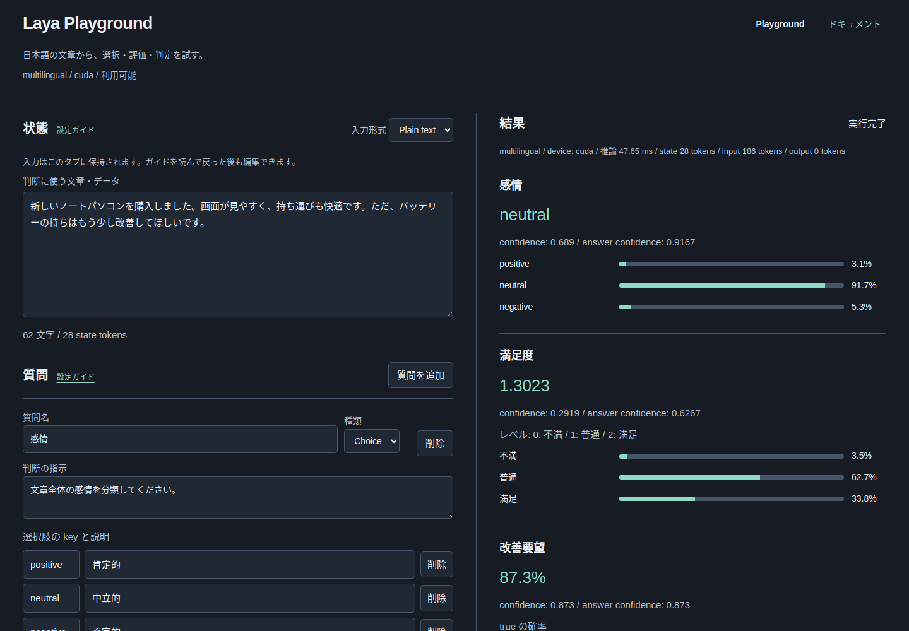

# Laya Playground & API Server

Layaをローカルで実行する **Web Playground兼APIサーバー**。日本語の文章やJSONを入力し、分類・スコア評価・真偽判定をブラウザやAPIから試せます。

- **ブラウザで検証** — Plain text／JSONから質問を作成し、回答・確率・スコアを確認。
- **APIとして利用** — 単発・バッチ推論に対応し、他のアプリから呼び出し可能。
- **日本語ドキュメント** — 状態・質問の設定方法と、コピーして試せる例題を掲載。
- **入力を保持** — 同じタブでドキュメントを確認しながら、編集を継続。



[クイックスタート](#クイックスタート) · [Playgroundの使い方](#playgroundの使い方) · [APIの使い方](#apiの使い方) · [サービス運用](#サービスとして運用する) · [動作環境と制限](#動作環境と制限) · [詳細仕様と検証](#詳細仕様と検証)

## クイックスタート

**検証環境はUbuntu 24.04・Python 3.12・uvです。** 対応するNVIDIA GPUがあればCUDAを使用し、CUDAが利用できない場合はCPUで実行します。CPUでもモデルを保持するRAMと、モデル・依存関係を保存する空き容量が必要です。OSや依存関係の対応範囲は[動作環境と制限](#動作環境と制限)を確認してください。

```sh
git clone https://github.com/git-Ktu/laya_playground.git
cd laya_playground
uv sync --locked
uv run uvicorn app.main:app --host 0.0.0.0 --port 8000 --workers 1
```

起動後は次のページを開いてください。

| ページ | URL |
|---|---|
| Web Playground | [localhost:8000](http://localhost:8000/) |
| 日本語の操作・設定ガイド | [localhost:8000/guide](http://localhost:8000/guide) |
| APIリファレンス（OpenAPI） | [localhost:8000/docs](http://localhost:8000/docs) |

> **起動時の注意**
>
> - 初回はHugging Faceからモデルをダウンロードするため時間がかかります。
> - モデルは起動時に一度ロードします。**1プロセス・1 worker**で起動してください。
> - **認証はありません。** 上記コマンドは全ネットワークインターフェースで待ち受けます。ローカル利用だけなら `--host 127.0.0.1` に変更してください。

GPU検証スクリプトは起動に必須ではありません。[任意のGPU動作確認](#任意のgpu動作確認)として分けています。

<details>
<summary>モデルのダウンロード・初回起動で失敗した場合</summary>

モデルのダウンロードには通常のHugging Faceキャッシュを使います。ネットワーク・空き容量・Hubの制限を確認してください。必要なら環境変数 `HF_TOKEN` を設定します。

ダウンロードまたはロード失敗時もサーバーは起動しますが、`/health` と推論は503になります。原因を解決してアプリを再起動してください。リクエストごとの再ロードはしません。

</details>

## Playgroundの使い方

1. **状態を入力** — 判断したい文章やデータを入力します。
2. **質問を設定** — 判断の指示と、分類・評価の基準を指定します。
3. **Runを実行** — Run／Ctrl+Enterで、回答・確率・token数・推論時間・実際のdeviceを確認します。Raw JSONも表示できます。

| 質問の種類 | 用途 | 結果 |
|---|---|---|
| Choice | 候補から分類する | 選択されたkeyと候補ごとの確率 |
| Score | 順序のある段階で評価する | 0〜段階数−1の実数のスコア |
| Noul | 条件が成り立つか判断する | trueの確率（0〜1） |

**JSON入力は「状態JSON」「質問JSON」の2欄**です。Runは現在の両欄を検証して直接実行します。適用操作は不要です。

Playgroundのヘッダーや各項目の「設定ガイド」から、日本語ドキュメントへ移動できます。同じタブのページ往復・再読み込み後も入力を復元します。状態・質問の設定方法、結果の読み方、コピーして試せる例題は `/guide` に掲載しています。`/docs` はOpenAPI、`/openapi.json` はAPIスキーマです。

<details>
<summary>JSON入力・形式の切り替え・LLMで作成する例題</summary>

入力形式で JSON を選ぶと、「状態 JSON」「質問 JSON」の2欄が表示されます。状態には state の値（文章は `"配送が遅れています。"` のように引用符付きの JSON 文字列、データは空でないオブジェクト・配列）、質問には質問名をキーにした辞書を貼り付けます。Run / Ctrl+Enter はその時点の両欄を検証して直接実行します。不正な入力は欄ごとに原因を表示し、推論を開始しません。

Plain text に切り替えると両欄を検証して状態・質問フォームへまとめて反映します。片方でも不正なら JSON モードを維持し、入力を保持します。オブジェクト・配列の状態はフォームでも整形 JSON として編集し、送信時の型を保持します。JSON に切り替えると最新のフォームを2欄へ反映します。リクエスト表示、JSON コピー、curl コピーは現在の入力を使用します。再取り込みにはコピーしたリクエストの `state` と `questions` をそれぞれの欄に分けてください。

LLM には、次のように **状態 JSON** と **質問 JSON** の2つのコードブロックを生成するよう依頼できます。

状態 JSON:
```json
{"body": "配送が遅れています。早く届けてほしいです。"}
```

質問 JSON:
```json
{
  "感情": {"type": "choice", "instructions": "感情を分類してください。", "criteria": {"positive": "肯定的", "negative": "否定的"}},
  "緊急度": {"type": "score", "instructions": "緊急度を評価してください。", "criteria": ["低い", "高い"]},
  "改善要望": {"type": "noul", "instructions": "改善を求めていますか。"}
}
```

</details>

## APIの使い方

Web画面とAPIは同じサーバーで動作します。問い合わせに対応が必要かを判定する最小例は、次のように送れます。

```sh
curl http://localhost:8000/v1/systemone \
  -H 'Content-Type: application/json' \
  --data-raw '{
    "state": "注文した商品が届かず、困っています。配送状況を確認してください。",
    "questions": {
      "要対応": {"type": "noul", "instructions": "担当者の対応が必要ですか。"}
    },
    "model": "multilingual",
    "max_len": 8192
  }'
```

結果は `answers` に返ります。Choiceは `choice`、Scoreは `score`、Noulは `noul` を読み取ります。確率・confidence・usage・routing・diagnosticsも確認できます。

| Method | Path | 用途 |
|---|---|---|
| GET | `/` | Playground |
| GET | `/guide` | 日本語の操作・設定ガイド |
| GET | `/health` | モデル利用可能なら 200、ロード失敗なら 503 |
| GET | `/info` | model_id、8192 上限、要求/実 device、パラメータ device、GPU、バージョン、fallback 回数 |
| POST | `/tokenize` | `{ "state": "日本語" }` の正確な state token 数 |
| POST | `/v1/systemone` | `{state, questions, model?, max_len?}` の単発推論 |
| POST | `/v1/systemone/batch` | `{states, questions, model?, max_len?}` の batch 推論 |
| GET | `/docs` | OpenAPI 対話式ドキュメント |
| GET | `/openapi.json` | API schema |

state は非空の文字列・JSON オブジェクト・配列です。questions は名前から質問への辞書で、type と非空 instructions を必須とします。Choice の criteria は key → 説明、Score は最低 2 段階の説明リスト、Noul は criteria 不要です。空入力、不正な質問、8192 超の state token 数は 422。標準サーバーの本文・質問数・選択肢数制限も適用します。

<details>
<summary>回答形式・3種類の質問・バッチ推論などの追加例</summary>

```sh
curl http://localhost:8000/v1/systemone \
  -H 'Content-Type: application/json' \
  --data-raw '{
    "state":"注文した商品が届かず、困っています。配送状況を確認してください。",
    "questions":{
      "分類":{"type":"choice","instructions":"問い合わせを分類してください。","criteria":{"配送":"配送の問い合わせ","その他":"その他"}},
      "緊急度":{"type":"score","instructions":"緊急度を評価してください。","criteria":["低い","普通","高い"]},
      "要対応":{"type":"noul","instructions":"担当者の対応が必要ですか。"}
    },
    "model":"multilingual","max_len":8192
  }'
```

単発の結果は標準の `model / answers / usage / routing` と追加の `diagnostics` です。Choice は `choice` に選択 key、Score は `score` に 0〜段階数−1 の実数、Noul は `noul` に 0〜1 の true 確率を返します。confidence、probabilities、legend も表示します。`model` は標準の `laya-rl-agent` になる場合があり、実 checkpoint は `routing.repo` と `diagnostics.model_id` で確認してください。

```sh
curl http://localhost:8000/v1/systemone/batch \
  -H 'Content-Type: application/json' \
  --data-raw '{"states":["配送が遅れています。",{"問い合わせ":"商品が届きました。"}],"questions":{"要対応":{"type":"noul","instructions":"担当者の対応が必要ですか。"}},"max_len":8192}'
curl http://localhost:8000/tokenize -H 'Content-Type: application/json' --data-raw '{"state":"日本語の文章"}'
curl http://localhost:8000/health
curl http://localhost:8000/info
```

batch は `results / total_usage` を維持し、各入力を `batch_size=1` で順次処理します。

</details>

## サービスとして運用する

Linuxではsystemdのユーザー権限で起動・停止できます。**付属設定の配置先は `~/work_space/laya_playground` です。** 別の場所にcloneした場合は、コピーしたサービスの `WorkingDirectory` と `ExecStart` を実際のパスに変更してください。

付属の [systemdユーザーサービス](deploy/systemd/laya_playground.service) を登録して運用できます。仮想環境は先に `uv sync --locked` で用意してください。サービスはその環境から直接起動し、起動時の依存関係の更新は行いません。Web アプリと API は同じ 1 プロセスで提供します。手動起動のサーバーは停止してから登録してください。

```sh
mkdir -p ~/.config/systemd/user
cp deploy/systemd/laya_playground.service ~/.config/systemd/user/
systemctl --user daemon-reload
systemctl --user enable --now laya_playground.service
```

ユーザー権限で操作できます。以下のコマンドに `sudo` は不要です。

```sh
systemctl --user start laya_playground.service
systemctl --user stop laya_playground.service
systemctl --user restart laya_playground.service
systemctl --user status laya_playground.service
journalctl --user -u laya_playground.service -f
```

<details>
<summary>自動起動・障害時の復旧・環境変数</summary>

`enable` によりユーザーの systemd 起動時に自動起動します。ログアウト後の継続や OS 起動時の自動起動は `Linger` 設定に依存します。検証機では有効です。利用環境では `loginctl show-user "$USER" -p Linger` で確認してください。自動起動を解除する場合は `systemctl --user disable --now laya_playground.service` を使います。

異常終了時は 5 秒後に再起動し、短時間の繰り返し失敗では再起動を止めます。原因を直した後は `systemctl --user reset-failed laya_playground.service` と `start` で復旧できます。モデルロードが完了するまでは HTTP を待つため、`active` に加えて `curl --fail http://127.0.0.1:8000/health` で利用可能か確認してください。ロード失敗時は `/health` が 503 を返すため、ログを確認してサービスを再起動します。

必要な場合のみ `~/.config/laya_playground/server.env` を作成し、`HF_TOKEN=...` などの環境変数を記述できます。このファイルはサービスから任意で読み込みます。秘密情報を含む場合は `chmod 600` で保護してください。通常は既存の Hugging Face キャッシュを使用します。

</details>

### LANから利用する

`hostname -I` でサーバーの LAN IP を確認し、同じ LAN の端末から `http://SERVER_IP:8000/` を開きます。検証は同一ホストのLANアドレスから行ったもので、別端末からの到達は未検証です。接続先 origin は開いたブラウザの origin を初期値にします。localhost でコピーした curl は別端末で使う前に IP を変更してください。

通常の HTTP LAN 接続で Clipboard API が使えない場合は従来のコピー処理を試し、失敗時には選択済みテキストを表示します。Ctrl+C / ⌘C で手動コピーできます。認証はありません。アクセスできるネットワークの端末から API を利用できます。

## 動作環境と制限

| 項目 | 現在の仕様・対応範囲 |
|---|---|
| アプリ構成 | FastAPI + HTML／JavaScript。Web画面とAPIを1プロセスで提供 |
| Python | 3.12（`>=3.12,<3.13`） |
| 検証環境 | Ubuntu 24.04、x86_64、GTX 1070（8 GB） |
| 推論device | CUDA優先。CUDAが利用できない場合はCPU |
| 依存関係 | Laya 0.3.22、PyTorch `2.7.1+cu126`（CUDA 12.6）固定 |
| モデル | `convaiinnovations/laya-multilingual` 固定。Router名は `multilingual` |
| 入力上限 | `max_len=8192` 固定。異なるモデルや上限指定は422 |
| 認証 | なし。アクセスできるネットワークの端末からAPIを利用可能 |

**GTX 1070専用ではありませんが、他のGPU・OSでの動作を保証するものではありません。** 現在固定しているtorch wheelはLinux x86_64／Windows x86_64向けです。Windowsでのアプリ動作は未検証です。macOSやLinux ARMでは、そのままの依存関係でインストールできず、環境に対応したPyTorch構成への変更が必要です。systemdの運用手順はLinux向けです。

CUDAを利用できない状態でのCPUロード・短い入力の推論は確認しています。CPUでもCUDA版PyTorchの依存関係をインストールする現在の構成です。CPU専用wheelに切り替える構成は用意していません。

### 長文とtoken上限

8192 は設定上限であり、8 GB GPU で最大長が必ず収まる保証ではありません。4000 state tokens 以上では UI に精度低下の警告を出し、8192 超は実行を止めます。質問 instructions と criteria にも token を使います。モデルの **head budget**（標準設定）内に収まらない質問や、質問を含めた系列では state が8192 以下でも切り捨てが起き得ます。`usage.truncated / state_tokens_dropped / truncated_questions` を必ず確認し、質問と文章を短くしてください。8192 token 級の実行と設定値の確認は別です。実測は [検証記録](docs/verification.md) にあります。

<details>
<summary>GPU検証環境・CPU fallback・エラーとログ</summary>

GTX 1070 / Pascal（compute capability 6.1）で検証しました。GTX 1070 Ti ではありません。`torch==2.7.1+cu126` を CUDA 12.6 の明示 uv index で固定しています。ドライバーの nvidia-smi に表示される CUDA 13.0 はドライバーの最大対応で、PyTorch runtime は 12.6 です。システム Python、CUDA toolkit、ドライバーを変更しません。別の新しい torch wheel に変更すると Pascal 対応がなくなる可能性があるため、CUDA tensor 演算と実モデル推論で確認してください。

CUDA エラー・OOM 時は Laya 標準の CPU fallback を許可します。`/info` と結果の diagnostics に実 device、model_parameter_device、cpu_fallback_count を出します。GPU 検証スクリプトは CPU fallback を成功扱いせず非ゼロ終了します。OOM 時は文章・質問を短くして他の GPU 使用プロセスを確認し、必要ならアプリを再起動します。モデル利用不能・CUDA/OOM は分類付き 503、その他の推論エラーは 500 で返します。通常の起動コマンドで、起動・モデルロード・CUDA/GPU/device・推論時間・分類済みエラーをログに出します。リクエスト本文と例外全文をログには出しません。

</details>

## 詳細仕様と検証

<details>
<summary>入力保持の保存範囲・復元時の挙動</summary>

入力は同じ origin・同じタブの `sessionStorage` に保持します。ガイドへの往復、Back / Forward、再読み込み後も、入力形式、状態・質問・criteria の順序、非表示のフォームと JSON 欄、接続先 origin、API リクエストの開閉、作業位置を復元します。JSON の構文エラー、重複名、空欄もそのまま保持され、戻って続きを編集できます。

保存するのは入力だけです。結果、token 数、モデル情報、実行中状態は保存せず、復帰後にモデル情報と token 数を確認します。推論を自動再送しません。実行中に移動するとブラウザーで応答の受け取りを取り消しますが、サーバーの GPU 推論自体の中断は保証しません。

localhost / LAN IP / ポートが異なると保存領域も異なります。別タブや端末へ同期せず、サーバーへ下書きを保存しません。保存が使えない場合も編集と Run を続けられます。内部リンクで移動する際には「このまま移動」「戻る」を選べる案内を表示します。壊れた保存データは使用せず、案内と既定の入力を表示します。タブ終了後の永続保存は行いませんが、ブラウザーのセッション復元により入力が復活する場合があるため、タブ終了で秘密情報が確実に消えるとは保証しません。

</details>

### テスト

プロジェクトのディレクトリで実行してください。通常のテストはモデルをロードしません。

```sh
uv run pytest -q
```

Chromeの画面テストは `google-chrome` があると実行し、なければskipします。

### 任意のGPU動作確認

以下は**GPU利用時の検証専用**です。Webアプリ・systemdの起動時に自動実行されるものではありません。GPUがない環境では失敗するため、CPU利用時には実行不要です。

```sh
# CUDA演算と実モデル推論を確認。Webサーバーの起動は不要
uv run python scripts/verify_gpu.py

# 起動済みサーバーのHTTP応答と実際のGPU推論を確認
uv run python scripts/verify_http.py --url http://127.0.0.1:8000

# 実モデル・GPUを使用するintegrationテスト
uv run pytest -m integration -q
```

これらの検証はCPU fallbackを成功扱いせず、非ゼロ終了します。

### 検証記録

- [初期のGPU・HTTP・ブラウザ検証](docs/verification.md)
- [JSON入力欄の検証](docs/json-editors-verification.md)
- [JSON直接実行の検証](docs/json-direct-run-verification.md)
- [systemd運用の検証](docs/systemd-verification.md)
- [日本語ガイド・入力保持・ナビゲーションの検証](docs/documentation-verification.md)

検証記録には実行時の環境・画面・ログを含みます。過去の検証時点の情報であり、現在の起動状態を示すものではありません。
