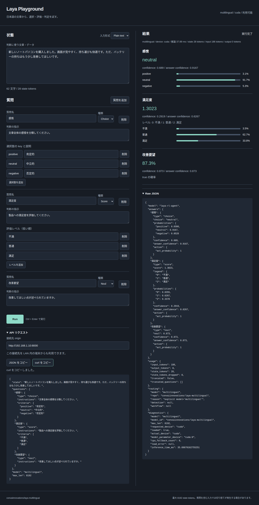

# 実環境検証記録 — 2026-10-02（Asia/Tokyo）

対象は Ubuntu 24.04.4 LTS、NVIDIA GeForce **GTX 1070 / 8192 MiB**、compute capability **6.1**。GTX 1070 Ti の検証ではありません。PyTorch **2.7.1+cu126**、CUDA runtime **12.6**、Laya **0.3.22**、Python 3.12。system CUDA/Python、driver、firewall は変更していません。

## コマンドと結果

| コマンド | 実測結果 |
|---|---|
| `uv sync --locked` | exit 0: `Resolved 67 packages in 1ms`, `Checked 65 packages in 0.61ms` |
| `uv run pytest -q` | exit 0: **103 passed, 1 deselected, 1 warning in 14.34s** |
| `uv run pytest -m integration -q` | exit 0: **1 passed, 103 deselected, 1 warning in 8.20s** |
| `uv run python scripts/verify_gpu.py` | exit 0: CUDA tensor sum of squares **1240**、standalone checkpoint 推論成功 |
| `uv run python scripts/verify_http.py` | exit 0: root/health/info/tokenize/日本語 Choice+Score+Noul/batch2件 |
| `uv run python scripts/verify_http.py --url http://192.168.1.10:8000` | exit 0: 同一ホストの LAN アドレスで全 HTTP チェック成功 |
| `curl -sS -o … -w '%{http_code}\n' http://127.0.0.1:8000/` | **200** |
| `curl -sS http://127.0.0.1:8000/health` | `{"status":"ok","model_ready":true,"load_error":null}` |
| `curl -sS http://127.0.0.1:8000/info` | model_id が standalone、actual_device cuda、params cuda:0、fallback0 |
| `curl -sS -H 'Content-Type: application/json' --data-binary @/tmp/laya-single.json http://127.0.0.1:8000/v1/systemone` | 日本語3種、標準 schema と値の範囲、routing.repo、GPU diagnostics の Python assertion 成功 |
| 同条件の `/v1/systemone/batch`（`@/tmp/laya-batch.json`） | 2件、total_usage、各結果の assertions 成功 |

通常 suite はモデルをロードしません。Chrome 実画面テスト6件を含みます。警告は依存 Starlette の TestClient に対する httpx deprecation 1件で、隠していません。

## GPU と実 checkpoint

既存実装の `Router(device=…)` は Laya の bundled repo を選ぶため、要求モデルを明示した `Router(models={'multilingual':'convaiinnovations/laya-multilingual'}, device=…)` に修正しました。既定 factory を patch した回帰テストで修正前の失敗、修正後の成功を確認。注入 mock だけの検証に限定していません。

Hugging Face standalone checkpoint を初回ダウンロードして実ロードし、単発・batch・HTTP・実ブラウザの **routing.repo が `convaiinnovations/laya-multilingual`** であることを確認。`/info` と結果にも `model_id` を追加しました。標準 response.model の `laya-rl-agent` は維持します。

wheel arch list は `sm_50, sm_60, sm_70, sm_75, sm_80, sm_86, sm_90`。6.1 GPU で tensor 演算とモデル推論を実行して互換性を確認しました。最終 GPU script の推論は **192.54 ms**、peak allocated **1,572,745,728 bytes**。Agent device **cuda**、model parameter **cuda:0**、推論前後 CPU fallback **0**。日本語サンプルの Choice は配送、Score は1.5548（0〜2）、Noul は0.982（0〜1）。特定ラベルの正解一致をテスト条件にしていません。

## 長文

サービス単発・batch と実推論では **max_len=8192** を指定。実長文は **4001 state tokens / 9818文字**、3質問、HTTP200、推論 **26,966.25 ms**、usage.input_tokens **12098**（質問ごとの合算）、state_tokens_dropped **0**、truncated **false**、fallback **0**。nvidia-smi で推論前 **1725 MiB**、推論後 **2285 MiB** を観測。この値は前後のサンプルであり、この長文の peak VRAM ではありません。

8192 実 state tokens 級の推論は未実施です。設定8192の確認、4001 token の成功、最大長の8GB適合は別の事実です。今回の実推論で truncation は発生しませんでした。切り捨て時の UI/usage 保存は mock 回帰テストで確認。質問 head budget も影響するため、8192以下の state でも常に無切り捨てとは限りません。

## ブラウザと LAN

`/usr/bin/google-chrome` + Playwright で実サーバー `http://192.168.1.10:8000/` にアクセスし、初期日本語 Choice/Score/Noul を Run。3回答、実 checkpoint、CUDA parameters、fallback0を Raw JSON で assertion。実推論 **35.70 ms**、state28 tokens、JavaScript page errors **0**。モバイル390pxで横にはみ出さないことも確認しました。

LAN HTTP は secure context **false**、Clipboard API **なし**。従来コピーへの fallback で curl コピー成功。コピーが両方失敗する回帰テストでは、テキストを選択して手動コピーを案内します（修正前は undefined.writeText エラーで失敗）。

**別端末からの到達確認は未実施**。同一ホストの LAN アドレスから成功したことだけを報告します。firewall の変更はしていません。

[モバイル画面](verification-artifacts/real-lan-mobile.png)。生の出力は [verification-artifacts](verification-artifacts/) 内の gpu.jsonl、http.jsonl、lan-http.jsonl、curl-single.json、curl-batch.json、long.json、browser.json、pytest.txt、integration.txt、sync.txt です。

## 起動状態

`uv run uvicorn app.main:app --host 0.0.0.0 --port 8000` を起動し、この検証終了時は稼働中。PID **3846**、Codex shell session **65128**。Playground: [localhost](http://127.0.0.1:8000/) / [LAN](http://192.168.1.10:8000/)。以後の環境終了や再起動で PID/起動状態は変わります。

## 最終修正後の再検証（2026-10-02）

上記103件のテスト、実 integration、長文・実ブラウザの記録は以前の実測として保存しています。最終修正はスクリーンショットの保存先を pytest `tmp_path` に変更し、通常の Uvicorn 起動でアプリ INFO ログを有効にしました。起動時に model/model_id、CUDA 利用可能性、GPU 名、要求 device、capability/arch list、モデルロード完了と実 device を記録し、既存の推論時間・分類済みエラーログを出します。リクエスト本文・例外全文は出しません。追加した起動診断が失敗してもモデルロードは続行します。

| コマンド | 最終実測結果 |
|---|---|
| `uv run pytest -q` | **105 passed, 1 deselected, 1 warning in 16.02s**、exit 0 |
| `node --check app/static/playground.js` | exit 0 |
| `uv sync --locked` | exit 0、67 packages resolved、65 checked |
| `.venv/bin/python -m pytest -q tests/test_playground_browser.py::test_edit_run_copy_and_mobile` | 新規コピー `/tmp/laya-portable-vx4wpb43` で1 passed、`.superpowers` なし、実 Chrome PNG を pytest 一時ディレクトリに保存 |
| `uv run python scripts/verify_gpu.py` | exit 0、GTX1070/CUDA、standalone checkpoint、params cuda:0、fallback0、tensor1240 |
| `uv run python scripts/verify_http.py --url http://192.168.1.10:8000` | exit 0、root/health/info/tokenize/単発3種/batch2件、CUDA、fallback0 |

新しい生データは `verification-artifacts/final-*` に別名で保存し、以前の記録を上書きしていません。通常suiteの警告は従来と同じ Starlette/httpx deprecation 1件です。最終 GPU script 推論157.49 ms、peak allocated1,572,745,728 bytes。サーバー実ログで startup/loading/loaded と単発327.31 ms、batch61.70 msを確認しました。最終修正後の長文・integration再実行は行っていません。

旧PID3846は既に停止していました。最終検証時は同じ起動コマンドで **PID32634 / Codex shell session24728** が稼働し、LAN `/health` は HTTP200/model_ready trueです。起動状態は環境終了等で変わります。
